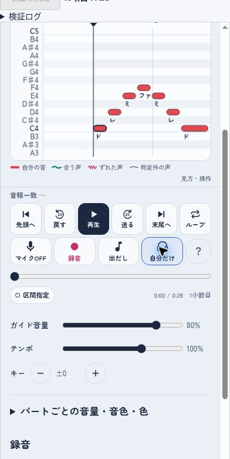

# 操作ボタン更新とバックグラウンド再生への引き継ぎ

記録日：2026-11-05（日本時間）。担当：ChatGPT / Codex。

> 追記（2026-11-05、Claude Code）：5章で依頼されたバックグラウンド再生を試作した。結果は [7章](#7-バックグラウンド再生の試作claude-code2026-11-05) にある。1〜6章は Codex の作業時点の記録として残している（「バックグラウンド再生は未実装」などの記述はその時点のもの）。

## 1. この記録の位置づけ

ユーザーから「ボタン・ヘルプ・ソロ・ループをパパが実装し、変更点をClaude Codeが読めるよう残して引き継ぐ」と依頼された。

作業ブランチは `codex/practice-controls-20261105`。PR #20 の `codex/chord-model-single-notes`、コミット `6a83eda01620dc511f2c15f138ea0fb8d0579a91` を土台にしている。PR #20の単音試聴・お手本1秒／3秒を含む。今回のPRはPR #20のブランチを取り込み先にする積み重ね方式で、差分には今回分だけを出す。

`main`の公開版にはまだ反映していない。Claude Codeは今回のブランチから続けること。PR #19には旧仕様の「全体10秒」があるので、今回の枝へ後からそのまま戻さない。

## 2. ユーザーが希望したこと

- 再生操作：先頭、送り／戻し、再生／一時停止、末尾、ループ。
- 送り／戻しの刻みは10秒を候補に挙げた。今回10秒で実装した。
- マイクON/OFF、録音、出だしの音、自分のパートだけ聴くON/OFF。
- ソロ中も画面表示は同じ。再生中にも切り替えられる。
- アイコンは絵文字を使わず、選定は任された。
- 「イヤホンで使ってください」などの長い説明は、提示されたスクショに似た丸い「？」から開く。
- 別アプリや画面ロック中も音楽を聴きたい。

以下の細部は実装者が選んだ初期仕様で、ユーザーが個別に指定したものではない：末尾ボタンは曲末尾で停止、初回のループは全曲、区間外へのシークでループOFF、ソロはパートのミュートより優先するが音量0%は尊重する。

## 3. 今回実装したこと

### 操作画面

上段：`rewBtn` / `backBtn` / `playBtn` / `forwardBtn` / `endBtn` / `repeatBtn`。
下段：`micBtn` / `recBtn` / `pitchBtn` / `soloBtn` / `transportHelpBtn`。

- SVGアイコンと短いラベル。10秒の矢印にはSVG内に数字10を表示。
- 「出だしの音」は狭い画面に合わせ、表示ラベルを「出だし」に短縮。アクセシブル名と説明は「出だしの音」。
- 丸い「？」は44px。長いイヤホンの説明は初期画面から外し、`transportHelp`のネイティブdialogへ移した。閉じるボタンとEscapeで閉じられる。
- スマホでは2段、低い横向き画面では操作の2段とタイムラインを左右に配置。
- 320px幅＋縦スクロールバーでも、主要ボタンに44pxの押し幅を確保。

確認した画面：

### 一時ソロ

- 状態：`S.solo`。`setSolo()` → `applyGains()` で現在のGainNodeを切り替える。
- `partLevel()` はソロ中、選択したパートの音量だけを返し、他を0にする。練習段階③④・自分のミュートも一時的に上書きして聴ける。
- `S.mode`、`S.showOthers`、`S.sel`、`S.pstate`、再生時計、表示範囲は変更しない。ON/OFFで再生を再始動しないので、伸ばしている音も途中から切り替わる。
- パート音量・ガイド音量は維持するため、0%なら無音。マイク音声のモニター機能ではない。
- ソロONのままパートを選び直したら、新しい自分のパートがソロになる。
- 新しい曲を開くとソロOFF。ソロは保存しない。
- 和音練習は別の独立した音源経路で、お手本は全パートを鳴らす約束がある。その間はソロ切替を無効にし、通常練習へ戻ると再び有効にする。元のソロ状態は保持する。

### 送り／戻し・ループ

- `seekRelative()` は曲のタイムライン上で±10秒。テンポを変えても曲の時刻で10秒。
- 再生中のシークはカウントを足さずに再生を続ける。曲の先頭／末尾を越えない。末尾では停止する。
- 区間外へシークするとリピートだけOFFにし、区間／しおりの設定は保持する。勝手に元の区間へ跳ね戻らないようにした。
- `S.loop.scope` は `all` / `section`。`loopRange()` が全曲／小節／しおりの範囲を返す。
- `repeatBtn` は主なループON/OFF。初期値は全曲、以後は最後に使った範囲を保持する。
- 既存の `loopBtn` は小さな「区間指定」ボタンとして残した。小節範囲を設定し、しおりも従来どおり区間リピートになる。
- `wholeLoopBtn` は区間設定から全曲へ戻す。
- 全曲ループONは再生中の位置を飛ばさず、終わりで先頭へ戻る。区間を有効にすると従来どおり区間先頭から。
- 録音中は先頭／末尾／±10秒／シークバー／ループ変更を無効にし、関数側にも移動禁止のガードを入れた。録音の開始・停止と音声形式は変更していない。テイクには全曲／区間の区別を残し、全曲録音を「区間」と誤表示しないようにした。

## 4. 実施した検証

### 確認済み

- `npm run test:unit`：既存のMIDI解析・音程推定・ビブラート・表示移動・入力設定・和音復帰・お手本に加え、`tests/transport_test.js`を実行。
- `tests/transport_test.js`：実装の関数を使い、4段階のソロと元のミュート／音量への復帰、選択変更、全曲と区間の範囲、再生中のシーク、曲末停止、録音中のガードを検証。
- クラウドChromiumで `tests/controls-browser.html`：**40項目 PASS**。本体をテスト用iframeへ読み込み、実際のAudioContext・GainNode・MediaRecorderを使う。API露出はテスト用コピーだけで、公開する本体にグローバルは追加していない。
- ブラウザで、再生中の±10秒、全4段階のソロ音量と復帰、実際の全曲折り返し、区間切替、録音後のテイクと操作復帰、和音画面との切替、ヘルプの開閉を確認。
- 320×548 / 360×640 / 390×780 / 560×360 / 844×390 / 1200×900 のiframeで、主要ボタン44px以上、ボタン同士の重なりなし、ページの横はみ出しなし、ボタン文字切れなしを確認。
- 既存の画面非表示時の停止処理が保たれていることもブラウザで確認。

### 未確認・限界

- スマホ実機、iPhone Safari、人の声、Bluetoothイヤホンでの聞こえ方は未確認。
- ブラウザのマイク入力は合成の無音ストリーム。実際のマイク許可は使っていない。
- 全既存Playwrightスイート（`test:e2e`等）は今回は実行していない。今回の結合テストと既存ユニットテストの結果を、それらの代わりに「全スイートPASS」と言い換えない。
- バックグラウンド再生は今回未実装。まだ画面を切り替えると通常練習は停止する。

## 5. Claude Codeにお願いしたい次の作業

目的は **別アプリへの切り替え／ホーム画面／画面ロック後もガイドを聴き続けること**。まず音楽の再生を対象とし、バックグラウンドでのマイク録音・音程採点まで対応したとは扱わない。

### 既存の試作を確認する

- PR #12：<https://github.com/daddyboubakiki-stack/Carapella/pull/12>
- ブランチ：`feature/background-listening-20261030`、確認した先頭 `f7056ba1e96c39651908703144e0ae3ee847cf78`。
- OfflineAudioContextでWAVを事前生成し、HTMLAudioElementとMedia Sessionで聴く方式。全曲ループや再生成、12分の上限がある。
- ただし古いベースの別の「聴くだけモード」で、試作の説明では練習段階を反映しない。現在の操作画面や一時ソロとの統合は別途必要。PR #12を丸ごとマージして完了とはしない。

### 最初に検討するところ

1. 今のWeb Audio方式を維持できるか、実機の制約からHTMLAudioElementによる再生経路が必要かを試作で判断する。
2. `schedule()` は40msごとに約0.35秒先まで予約する。非表示時のタイマーやAudioContextの停止を考慮する。「visibilitychangeでpauseする行を消すだけ」で安定したと決めない。
3. `setAudioSession()` は既に存在し、マイク使用に合わせて `playback` / `play-and-record` を切り替えている。Media Sessionの追加だけでバックグラウンド動作が保証されるわけではない。
4. 通常再生の `S.solo`、練習段階、パート音量・ミュート、音色、テンポ、キー、全曲／区間／しおりのループを、新しい再生経路でも矛盾させない。
5. 「別の画面になった」「電話等で音声を中断された」「ページを実際に離れた」を区別し、中断後の古い再生要求や和音試聴を勝手に復活させない。
6. 対応環境ではロック画面から再生／停止／±10秒と曲名を扱う。前面へ戻ったら、実際の再生位置と譜面を同期させる。
7. ユーザーの希望は通常のプレイヤーで聴き続けること。別の専用画面や複雑な切替を増やす場合は、操作上の理由を説明する。

設計の変更や検証方法への反論・改善案を歓迎する。端末で確認できない部分を無理に断定しない。

### 実機の成功条件

- Android Chromeを優先し、別アプリへ切り替え／画面ロックで1曲分（5分程度）の再生が続く。
- 曲中の休符を挟んでも続く。全曲／区間ループで数回折り返す。
- 画面へ戻っても再生位置・譜面が合い、ソロ・練習段階・テンポ・キーが勝手に変わらない。
- ロック画面操作、イヤホンの抜き差し、電話などの中断後も停止状態が矛盾しない。
- iPhone SafariはAndroidと別に確認する。片方だけの結果を両方の対応とみなさない。

参考：
- GoogleのMedia Session解説：<https://web.dev/articles/media-session>
- Audio Session仕様草案：<https://www.w3.org/TR/audio-session/>

## 6. 変更ファイル

- `index.html`：画面・ソロ・シーク・ループ。
- `tests/transport_test.js`：再生／ミックスのユニットテスト。
- `tests/controls-browser.html`：ブラウザ結合テスト。
- `package.json`：上記ユニットテストを `test:unit` に追加。
- `README.md` / `tests/README.md`：機能・検証方法の案内。
- `CLAUDE.md`：Claude Codeが開始時に参照できる案内。
- このファイル：実装内容・検証結果・未完了範囲・次の成功条件。

## 7. バックグラウンド再生の試作（Claude Code、2026-11-05）

作業ブランチ：`ccr-001832f8-hl0opq`（`codex/practice-controls-20261105` の `d83bc81` から作成）。`main` へのマージ・公開はしていない。

### 7.1 何ができるようになったか

マイクと録音を使っていない「聴いているだけ」の再生中に、別アプリへの切り替え・ホーム画面・画面ロックをしても、同じ設定のまま音が続くようにした（**Chromiumでは確認済み、スマホ実機は未確認**）。

- 普段どおり「再生」を押すだけ。専用の画面や切り替えボタンは足していない（ユーザーの希望「通常のプレイヤーで聴き続けたい」に合わせた）。
- 反映する設定：自分だけ（ソロ）・練習の段階①〜④・パートの音量／ミュート・音色・ガイド音量・テンポ・キー・全曲／区間／しおりのループ・カウント（③④のカウント中の最初の音も）。
- 前面に戻ると、裏で聴いていた位置から通常の再生に戻り、譜面が自動追従に戻る。「画面を離れている間も再生を続けました。」と出る。
- ロック画面（対応端末）：曲名、再生／一時停止、10秒送り／戻し。10秒は画面のボタンと同じく曲の時刻で動く。
- 「？」の中に「画面を切り替えても聴く（試験中）」の説明と、状態（準備できているか）・直前の引き継ぎの記録を表示する。実機で確かめる時の手がかり。

引き継がない（従来どおり一時停止する）とき：マイクON・録音中・録音の聴き返し中・和音練習中。マイクONの時は「マイクを使っている間は、ほかの画面に切り替わると一時停止します。」と出す。バックグラウンドでのマイク録音・音程判定は対象外。

### 7.2 仕組みと、選んだ理由

**前面は今までどおり Web Audio、裏は端末内で作った音声ファイル（WAV）を `<audio>` で鳴らし、画面が隠れた瞬間に引き継ぐ。**

1. 曲を開いた時・設定を変えた時（0.6秒待ってから）、今の設定と同じ音を `OfflineAudioContext` で端末の中だけで作り、WAVにする（サーバーには送らない）。音を作る部品（`mixerGraph`・`noteVoice`・`clickVoice`）は通常の再生と同じ関数を使う。音量は通常の再生と同じ `partLevel()` から取るので、ソロ・段階・ミュートの約束が食い違わない。
2. 前面で再生中は、その音声を**消音のまま** `<audio>` で回しておく（位置は合わせない）。iPhoneでは、画面に触れた操作の中で一度再生した `<audio>` でないと後から鳴らせないため。音声の完成前は無音の短い音声で同じことをする。
3. 画面が隠れた（`visibilitychange`）瞬間に、Web Audio の予約（40msごと）を止め、今聞こえている位置へ `<audio>` を移して消音を解く。ループの時は「間→カウント→区間→余韻」の1周分の音声を作り、`<audio>` の繰り返しで回すので、裏で JavaScript が動かなくても回る。
4. 戻った時は `<audio>` の位置を曲の時刻に直し、そこから Web Audio の再生に戻す。音声の再開を待つ必要がある端末では、その間も `<audio>` の音と位置で譜面を動かし、画面に触れた時に切り替える（iPhoneは操作の中でないと音声を再開できないことがあるため）。
5. `<audio>` が裏で止まった（ロック画面・イヤホンのボタン・電話・曲の終わり）時は、アプリ側も一時停止として扱い、戻った時にその位置を表示する。勝手に再開しない。ページ自体を離れた（`pagehide`）時は全部止める。

**この方式にした理由**

- 「隠れたら一時停止」をやめるだけでは、裏でタイマーが止まる・遅れる（特にiPhone）ので、0.35秒先までの予約が途切れる。iPhoneでは Web Audio 自体も止められる。裏で確実に続くのは、普通の音声ファイルの再生（ポッドキャストと同じ形）。
- かといって前面も `<audio>` にすると、ソロや音量を変えるたびに作り直しの数秒待ちが出る。マイクの判定は Web Audio の時計で声との時刻を合わせている。前面の操作感とマイク練習を変えないため、前面は Web Audio のままにした。
- PR #12 は「聴くだけ」の別画面で、手動で作り直し、練習段階を反映しない方式だった。そのまま取り込むと今回の操作画面・ソロ・ループ、PR #20 のお手本と食い違うので、取り込まなかった。WAVへの変換（`wavBlob`）と `OfflineAudioContext` で作る考え方、Media Session、長さの上限は参考にした。

**作る時間の工夫**：全部の音を最初に並べると、鳴っていない音の部品も毎回計算されて非常に遅かった（5パート5分・3017音で74秒）。作る途中を2秒ごとに一時停止して、次の2秒に始まる音だけを足し、鳴り終わった音を外すようにした（同じ曲で約2秒）。途中で止められないブラウザでは全部並べて作る（遅いが音は正しい）。

**上限・負荷**：テンポを反映した長さが15分を超えると作らない（「？」に理由を出す）。WAVは22,050Hz・16bit・モノラル（5分で約13MB）。直近2つまで保持する（ループのオン／オフを行き来しても作り直さないため）。

### 7.3 検証したこと

区分：**自動（Node）**＝実装の関数を取り出して検証／**Chromium**＝クラウドの Linux 上の Chromium（Playwright 1.63）で実際の AudioContext・`<audio>` を使って検証。画面が隠れたことは `document.visibilityState` を書き換えて知らせた（本物の画面ロックではない）。

- 自動（Node）`tests/background_test.js`（`npm run test:unit` に追加）：
  - 設定（ソロ・段階・ミュート・音量・音色・テンポ・キー・ガイド音量・ループ範囲・カウント）を変えると、用意する音声が変わる。ソロ中に段階を変えても、聞こえる音は同じなので作り直さない。
  - 曲の時刻⇔音声ファイルの時刻の対応（テンポ・カウント・ループの余韻を含む）。
  - 隠れた時：聴くだけなら引き継ぐ。マイク・録音・聴き返し・和音練習・音声が古い時は引き継がない。作っている途中なら完成を待つ。
  - カウント中・テンポ50%・区間ループの位置合わせ、ロック画面の±10秒が区間の中に収まる。
  - ロック画面・イヤホン・電話・曲の終わり・端末に断られた時に、一時停止として矛盾なく扱う。
- Chromium `tests/background_browser.js`（`npm run test:background`）：**30項目 OK・NG 0**。
  - 用意した音声を読み戻して測った：通常の長さ、ソロで他パートだけの所が無音、③で自分だけの所が無音、音量0%で無音、キー＋3で音の高さが3半音上（測定誤差0.01半音未満）、テンポ50%で長さ2倍、区間ループの1周（間→カウント→区間の最初の音）。
  - 隠れた瞬間に Web Audio を止め、聞こえていた位置（差0.05秒未満）から `<audio>` が鳴る。2.5秒後も進み、Web Audio の音は残っていない。戻ると `<audio>` の位置（差0.02秒未満）から通常の再生に戻り、続く。
  - テンポ50%・キー＋2：裏で2秒たつと曲の1秒ぶん進む。戻ってもテンポ・キーは変わらない。
  - 区間ループ：裏で区間の終わりを越えると、区間の始まりのカウントへ戻る。カウント中に戻ると区間の始まりからカウントして続ける。
  - ロック画面の操作（Media Session の処理を直接呼んだ）：10秒送り／戻し、一時停止、再生。止めたまま戻ると、その位置で止まっている。曲名と再生状態。
  - 曲の終わりで止まり、戻ると末尾を表示。`pagehide` で `<audio>` も止まる。
  - マイクON：音声を回さず、隠れたら一時停止して理由を出す。ソロを押した直後に隠れても、新しい音声の完成を待って引き継ぐ（待つ間も鳴り続ける）。`<audio>` の再生を断られたら一時停止にして理由を出す。曲を替えると準備し直す。
  - ページのエラーなし。
- 作る時間（同じクラウドの4コアのLinux、Chromium。スマホではもっと遅いはず）：デモ曲（29秒）0.1〜0.2秒／5パート5分（3017音）「やわらか」約2秒、全パート「声（アー）」約8秒。
- 既存のテストへの影響：`npm run test:unit` 31項目 PASS（既存＋新規）。`tests/controls-browser.html` 41項目 PASS（最後の「画面切替で停止」の確認を、新しい動き「聴くだけは引き継いで続ける／戻ると同じ位置」の2項目に置き換えた）。既存の Playwright スイートの結果は 7.4 に書く。
- 既存テストの変更：`tests/chord_recovery_test.js`（隠れた時の処理に引き継ぎの判断が入ったため、引き継がない時は従来どおり止める・引き継いだ時は止めない、を確認するように変更）、`tests/transport_test.js`（音量変更時の準備の呼び出しを空の関数で受ける）、`tests/e2e2.js`（「画面切替で一時停止」の項目名を「マイク使用中に」と明記。判定は変えていない）。

### 7.4 既存の Playwright スイート（Chromium、2026-11-05に実行）

| コマンド | 結果 |
|---|---|
| `npm run test:e2e` | NG 0 |
| `npm run test:parts` | NG 0 |
| `npm run test:chord`（3サイズ） | NG 0 |
| `npm run test:zoom` | NG 0 |
| `npm run test:layout` | NG 0 |
| `npm run test:share` | API 13項目 PASS・画面 NG 0 |
| `npm run test:marks` | **途中で止まる（今回の変更前から）**。28項目 OK の後、11番目の手順で「しおりのチップ」を押せずタイムアウト |

`test:marks` は、今回の変更を入れる前の `d83bc81`（PR #21 の先頭）でも同じ位置・同じ28項目で止まることを確かめた。原因：その手順はチップを押す前に `seekTo(0)` で先頭へ移動する。PR #21 から「区間の外へ移動するとループをオフにする」仕様になったため、区間設定欄（しおりのチップを含む）が隠れる。しおり自体は残っている（再生バーの下の印も1つある）。古い版でもループがオフの時はチップを隠していたので、画面が壊れたというより、テストが PR #21 の仕様に追いついていない。テストの直し方（移動の前にチップを押す、など）は PR #21 の仕様の確認と合わせて決めるのがよいので、今回は変えていない。

### 7.5 未確認のこと・限界（実機で確かめるまで「対応済み」とは言えない）

- **スマホ実機は一度も試していない。** Android Chrome・iPhone Safari のどちらでも、画面ロック／別アプリ／ホーム画面で本当に続くかは未確認。片方の結果を両方の対応とみなさない。
- 消音の `<audio>` を隠れた瞬間に鳴らす方式が、iPhoneで間に合うか（隠れた直後に Safari がページを止める順番）。間に合わなければ「直前」に何も残らないか、戻った時に止まっている。
- 戻った時に iPhone で Web Audio がすぐ再開できるか。できない場合は画面に触れた時に切り替わる設計だが、未確認。
- Bluetoothイヤホン、イヤホンの抜き差し、電話・アラームでの中断の後の状態。
- Android の通知欄・ロック画面に曲名や操作が出るか。前面に戻った後、通知が残るか。
- スマホで音声を作る時間（特に「声（アー）」・長い曲・テンポ50%）。その間に画面を切り替えた時の「完成を待つ」動き。iPhoneでは待つ間に Web Audio が止められ、一時停止になる可能性が高い。
- 端末のメモリ（WAV最大2つ＋作る途中の音声）。
- 前面で Web Audio と消音の `<audio>` を同時に動かすことの副作用（音が途切れる・電池）。
- パソコンのブラウザでも、マイクOFFならタブを切り替えても止まらなくなった（以前は止まった）。意図した変更だが、使い方として問題ないかはユーザーの判断。
- アーティファクト（claude.ai の中）では、マイク・保存・共有リンクが使えない。`<audio>` に端末内の音声を渡す仕組みが許されるかも未確認なので、バックグラウンド再生の実機確認には向かない。

### 7.6 スマホで試してほしい手順

**準備**：プレビューURL <https://carapella-preview.daddyboubakiki.workers.dev/> を開く（7.10。公開URLは `main` のまま）。Android は Chrome、iPhone は Safari で開く（LINEの中では開かない）。見出しが「アカペラ練習帳（プレビュー）」になっていれば正しいページ。マイクはOFFのまま。

記録：端末名・OSの版・ブラウザ・イヤホン（なし／有線／Bluetooth）・結果（○できた／×できない／△気になる）・止まった時刻。×や△の時は「？」を開き、「状態」と「直前」の行を写真に撮る。

1. デモ曲（または5分くらいの曲）を開き、自分のパートを選ぶ。5秒ほど待ち、「？」に「状態：準備できています」と出るか。
2. 「再生」→ 10秒ほど聴いてから**画面ロック**。1曲分（5分程度、曲中の休符を含む）続くか。
3. ロック画面に曲名「（曲名）／アカペラ練習帳」と、再生・一時停止・10秒送り／戻しが出るか。押して効くか。
4. ロックを解いてアプリへ戻る。聴いていた位置と譜面が合っているか。「画面を離れている間も再生を続けました。」と出るか。そのまま再生が続くか。
5. 2〜4を、**別アプリ（LINEなど）への切り替え**と**ホーム画面へ移動**でも試す。
6. ループ：「ループ」を全曲にして、曲の終わり近くでロック → 先頭へ戻って続くか（カウントが入る）。「区間指定」で2小節にして、ロックしたまま数回繰り返すか。
7. 設定：「自分だけ」ON、段階③、テンポ75%、キー＋2 にして、「？」が「準備できています」になってからロック。聞こえる音がその設定どおりか。戻った時に設定が変わっていないか。
8. 中断：ロック中にイヤホンを抜く／タイマーのアラームを鳴らす／（できれば）電話を受ける。その後、止まった・続いたのどちらでも、ロック画面とアプリへ戻った時の表示（再生中か一時停止か・位置）が合っているか。勝手に昔の位置から鳴り出さないか。
9. マイクON で再生してロック → 一時停止し、戻ると「マイクを使っている間は…」と出るか（これは意図どおりの動き）。
10. 「自分だけ」を押した**直後（1秒以内）**にロック → 続くか、止まるか（完成を待つ動きの確認。止まっても異常ではないが記録する）。

### 7.7 ユーザーに決めてほしいこと

- ~~実機で試すURL~~ → **ユーザーの決定（2026-11-05）**：公開版を変えずにプレビューを用意し、まずユーザーの Android Chrome で確認する。7.10のURLを使う。
- **マイクON中に画面を離れた時**：今は従来どおり一時停止。「マイクを自動で切って音楽だけ続ける」案もある（裏で声を判定しないことは同じ）。
- **「？」の中の状態表示**：試験中の手がかりとして出している。実機確認が済んだら、短くするか残すか。
- **「声（アー）」の作成時間が長すぎた場合**：音色のフィルターを音ごとではなくパートごとにかける近似で、約2.2倍速くなる。通常の再生との差は −38 dB（音の大きさの約1.3%）と測った（Chromium、合成音。聞き比べはしていない）。採用は実機で時間を測ってから。

### 7.8 次の一手

1. 7.6の手順で Android Chrome を試す（成功条件は5章の「実機の成功条件」）。
2. 同じ手順で iPhone Safari を試す。
3. 結果をこの文書に追記し、失敗した箇所（「直前」の記録）から直す。うまくいかない端末向けの代案：Web Audio の出力を `MediaStreamAudioDestinationNode` で `<audio>` に流す（前面と同じ音のまま。ただし裏で JavaScript が動き続ける必要があり、iPhoneでは期待しにくい）。

### 7.9 変更ファイル

- `index.html`：音の部品を共通化（`mixerGraph`・`noteVoice`・`clickVoice`。通常の再生の音は変えていない）、バックグラウンド再生（`B`・`bg*` の関数）、時刻の関数（`songNow`・`viewTime`・`voiceTime`）が引き継ぎ中は `<audio>` の位置を使う、隠れた時／戻った時の処理、「？」の説明と状態。
- `tests/background_test.js`（新規）・`tests/background_browser.js`（新規）・`package.json`（`test:unit` に追加、`test:background` を追加）。
- `tests/chord_recovery_test.js`・`tests/transport_test.js`・`tests/controls-browser.html`・`tests/e2e2.js`：7.3のとおり。
- `README.md`・`CLAUDE.md`・`tests/README.md`・`docs/device-checklist.md`・この文書。

### 7.10 プレビューURL（2026-11-05 作成）

**URL：<https://carapella-preview.daddyboubakiki.workers.dev/>**（ユーザーの依頼で作成。公開版の GitHub Pages と `main` は変えていない）

- 仕組み：ユーザーの Cloudflare アカウントに Worker `carapella-preview` を作り、GitHub にある **コミット `c8e361f` の `index.html`** をそのまま配る（見出しとタブの名前に「（プレビュー）」を足すだけ）。コミットを固定しているので、ブランチに後から何か足しても、この Worker を作り直すまで中身は変わらない。
- 検索に載らないよう `X-Robots-Tag: noindex` を付けた。ただしURLを知っている人は誰でも開ける（アプリの中身は公開リポジトリと同じ）。
- 確認したこと：URLの中身が `c8e361f` の `index.html` と（「プレビュー」の2か所以外）同じ。Chromium の Android（Pixel 7）相当の表示で、デモ曲の準備→再生→隠す→3秒後も進む→戻ると続きから、を確認（エミュレーションで、実機ではない）。
- 公開版との違い：
  - 端末に記憶する設定・しおり・パートの色と音色は、公開版と別に保存される（URLが違うため）。プレビューで初めて開くと初期設定。
  - 「共有リンク」は使えない（共有APIが公開版のページからの読み書きだけを許しているため。APIの設定は変えていない）。
- 中身を更新する時：Cloudflare API で Worker `carapella-preview` のコード中の `COMMIT` を新しいコミットに替えて、同じ名前で上書きする。
- やめる時：Cloudflare のダッシュボード（Workers & Pages → `carapella-preview` → 削除）か、API の `DELETE /accounts/{account_id}/workers/scripts/carapella-preview`。共有API（`carapella-share`）とは別の Worker なので、消しても公開版や共有リンクには影響しない。
